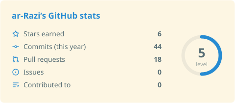
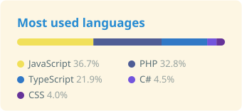
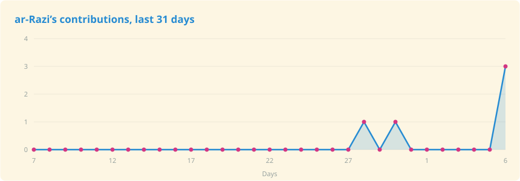

<!-- studio:settings user=FahrulFahmi theme=auto hl=2 border=hide light=solarized-light -->

<!-- studio:raw -->
<!--
  GitHub Profile README
  Fahrul Fahmi
-->

<!-- studio:header -->
<h1 align="center">Hi, I'm Fahrul Fahmi 👋</h1>

<!-- studio:raw -->
<h3 align="center">Senior Software Engineer | Former Technical Lead</h3>

  Building Software, Solving Problems, Creating Impact.

  
  

<!-- studio:divider -->

<!-- studio:raw -->
## About Me

I'm Fahrul Fahmi, a Senior Software Engineer with experience in developing and maintaining web applications across frontend and backend technologies.

I enjoy solving technical problems, building maintainable software, and exploring better approaches to designing reliable and scalable applications.

Throughout my career, I've worked with different technologies, collaborated with engineering teams, and taken on technical leadership responsibilities.

I'm continuously learning and improving my knowledge of software architecture, system design, cloud infrastructure, and engineering best practices.

<!-- studio:about -->
- 🔭 Currently working on web applications and software engineering projects.
- 🌱 Currently learning System Design, Software Architecture, Cloud Infrastructure, DevOps, and Application Security.
- 👯 Open to collaborating on open-source projects, full-stack applications, and developer tools.
- 💬 Ask me about React, TypeScript, Next.js, Go, Node.js, Express.js, and Software Engineering.
- 🤝 Open to meaningful collaborations and new professional opportunities.
- ⚡ Fun fact: I enjoy exploring how things work, solving challenging problems, and turning ideas into practical software solutions.

<!-- studio:divider -->

<!-- studio:stack -->
<h2 align="center">Tech stack</h2>

  <b>Frontend</b> 
  <picture>
    <source media="(prefers-color-scheme: dark)" srcset="https://raw.githubusercontent.com/FahrulFahmi/FahrulFahmi/main/profile-assets/stack-frontend-dark.svg?i=js%2Cts%2Creact%2Cvue%2Cnextjs%2Cmaterialui%2Ctailwind&perline=10" />
    
  </picture>

  <b>UI and UX design</b> 
  <picture>
    <source media="(prefers-color-scheme: dark)" srcset="https://raw.githubusercontent.com/FahrulFahmi/FahrulFahmi/main/profile-assets/stack-ui-and-ux-design-dark.svg?i=figma&perline=10" />
    
  </picture>

  <b>Backend</b> 
  <picture>
    <source media="(prefers-color-scheme: dark)" srcset="https://raw.githubusercontent.com/FahrulFahmi/FahrulFahmi/main/profile-assets/stack-backend-dark.svg?i=nodejs%2Cexpress%2Cgo%2Crust%2Cpostgres%2Credis&perline=10" />
    
  </picture>

  <b>Mobile</b> 
  <picture>
    <source media="(prefers-color-scheme: dark)" srcset="https://raw.githubusercontent.com/FahrulFahmi/FahrulFahmi/main/profile-assets/stack-mobile-dark.svg?i=swift%2Ckotlin%2Cflutter%2Cdart%2Candroidstudio%2Capple%2Cfirebase&perline=10" />
    
  </picture>

  <b>Data</b> 
  <picture>
    <source media="(prefers-color-scheme: dark)" srcset="https://raw.githubusercontent.com/FahrulFahmi/FahrulFahmi/main/profile-assets/stack-data-dark.svg?i=py%2Cmysql%2Cmongodb%2Csqlite%2Ckafka%2Crabbitmq&perline=10" />
    
  </picture>

  <b>Tools</b> 
  <picture>
    <source media="(prefers-color-scheme: dark)" srcset="https://raw.githubusercontent.com/FahrulFahmi/FahrulFahmi/main/profile-assets/stack-tools-dark.svg?i=vscode%2Cneovim%2Cidea%2Cgit%2Cgithub%2Cpostman%2Cnotion&perline=10" />
    
  </picture>

  <b>DevOps and cloud</b> 
  <picture>
    <source media="(prefers-color-scheme: dark)" srcset="https://raw.githubusercontent.com/FahrulFahmi/FahrulFahmi/main/profile-assets/stack-devops-and-cloud-dark.svg?i=docker%2Ckubernetes%2Caws%2Cgcp%2Cazure%2Cterraform%2Cansible%2Cgithubactions%2Cnginx%2Clinux&perline=10" />
    
  </picture>

<!-- studio:divider -->

<!-- studio:stats+langs -->
<h2 align="center">GitHub Statistics</h2>

  <picture>
    <source media="(prefers-color-scheme: dark)" srcset="https://raw.githubusercontent.com/FahrulFahmi/FahrulFahmi/main/profile-assets/card-stats-dark.svg?show_icons=true" />
    
  </picture>
  <picture>
    <source media="(prefers-color-scheme: dark)" srcset="https://raw.githubusercontent.com/FahrulFahmi/FahrulFahmi/main/profile-assets/card-langs-dark.svg?layout=compact&langs_count=5" />
    
  </picture>

<!-- studio:achievements -->
## Achievements

  
  
  
  
  

<!-- studio:gist -->
## Gists

  <a href="https://gist.github.com/6cad326836d38bd3a7ae"><picture>
    <source media="(prefers-color-scheme: dark)" srcset="https://raw.githubusercontent.com/FahrulFahmi/FahrulFahmi/main/profile-assets/card-gist-6cad326836d3-dark.svg?id=6cad326836d38bd3a7ae" />
    
  </picture></a>
  <a href="https://gist.github.com/0831f3fbd83ac4d46451"><picture>
    <source media="(prefers-color-scheme: dark)" srcset="https://raw.githubusercontent.com/FahrulFahmi/FahrulFahmi/main/profile-assets/card-gist-0831f3fbd83a-dark.svg?id=0831f3fbd83ac4d46451" />
    
  </picture></a>

<!-- studio:snake -->

  <picture>
    <source media="(prefers-color-scheme: dark)" srcset="https://raw.githubusercontent.com/FahrulFahmi/FahrulFahmi/main/profile-assets/card-snake-dark.svg?snake=800080&dots=github" />
    
  </picture>

<!-- studio:city light=green-animate dark=night-rainbow -->

  <picture>
    <source media="(prefers-color-scheme: dark)" srcset="https://raw.githubusercontent.com/FahrulFahmi/FahrulFahmi/main/profile-assets/card-city-dark.svg?light=green-animate&dark=night-rainbow" />
    
  </picture>

<!-- studio:activity -->
<h2 align="center">Contribution Activity</h2>

  <picture>
    <source media="(prefers-color-scheme: dark)" srcset="https://raw.githubusercontent.com/FahrulFahmi/FahrulFahmi/main/profile-assets/card-activity-dark.svg?area=true" />
    
  </picture>

<!-- studio:divider -->

<!-- studio:raw -->
## Let's Connect

I'm always open to connecting with fellow engineers, sharing knowledge, collaborating on interesting projects, and exploring new professional opportunities.

<!-- studio:socials -->

  

<!-- studio:raw -->

  <i>Thanks for visiting my profile!</i>

